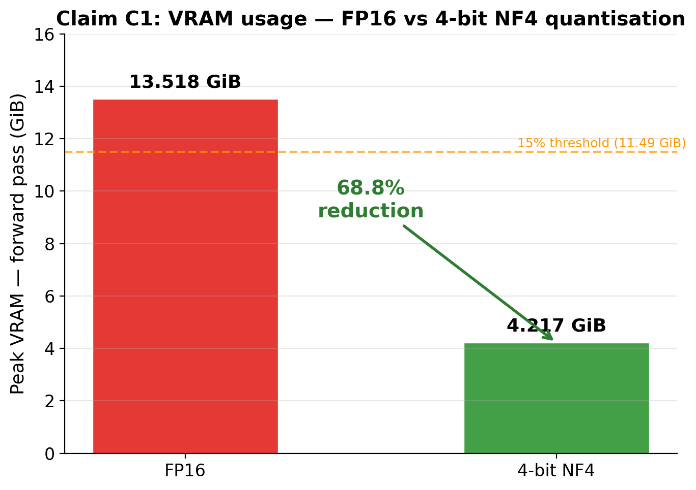
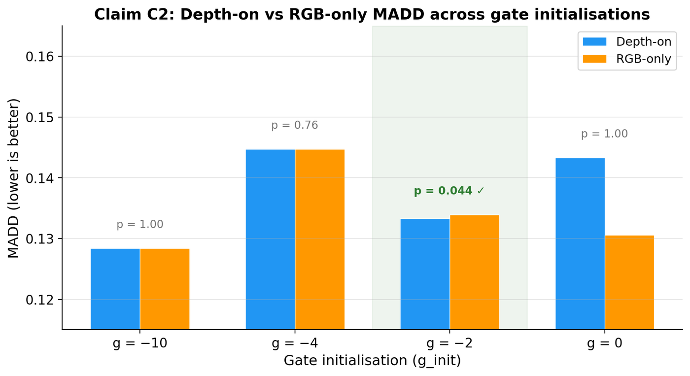
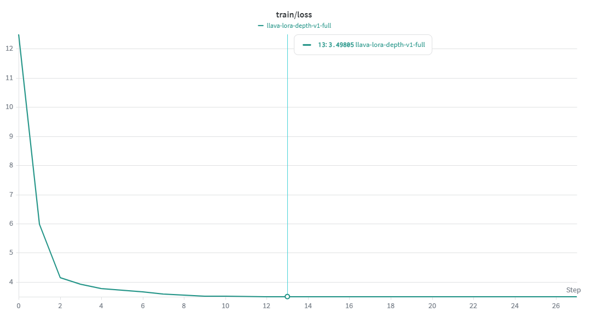

# Optimizing Multimodal AI — Depth-Aware Fine-Tuning Pipeline

Bachelor thesis implementation (ETSETB–UPC, 2026). Fine-tunes **LLaVA-1.5-7B**
with **QLoRA** and a **gated late-fusion DepthEncoder** so a vision-language
model can exploit RGB-D data — trained end to end on a single free-tier
**NVIDIA T4**.

The research question: can a small open-source VLM be efficiently adapted to use
depth information on consumer hardware, and can the contribution of depth be
*measured* rather than asserted?

## Results

Four claims were pre-registered with explicit thresholds before running the
experiments. All four passed.

| Claim | Description | Target | Observed | Status |
|---|---|---|---|---|
| C1 | VRAM reduction (4-bit vs FP16) | ≥ 15% | **68.8%** | PASS |
| C2 | Depth-on MADD < RGB-only | p < 0.05 | **p = 0.044** | PASS |
| C3 | Pipeline stability | ≥ 85% | **97.6%** | PASS |
| C4 | Geometric consistency (ΔMADD) | ≤ 5% | **0.4%** | PASS |

### C1 — Efficiency

4-bit NF4 quantisation with double quantisation cuts peak forward-pass VRAM from
**13.518 GiB to 4.217 GiB**, a 68.8% reduction. That brings a 7-billion-parameter
model comfortably inside a consumer T4 budget.



### C2 — Does depth actually help?

The central claim. Four independent training runs on the full NYU Depth v2 split
varied only the gate initialisation `g_init`, holding everything else constant
(lr = 2×10⁻⁴, 3 epochs, batch 2 × 8 gradient accumulation).



| `g_init` | Depth-on MADD | RGB-only MADD | p (bootstrap) | Status |
|---|---|---|---|---|
| −10.0 | 0.1284 | 0.1284 | 1.000 | not significant |
| −4.0 | 0.1447 | 0.1447 | 0.758 | not significant |
| **−2.0** | **0.1333** | **0.1339** | **0.044** | **significant** |
| 0.0 | 0.1433 | 0.1306 | 0.999 | not significant |

Only `g_init = −2.0` is significant, and the effect is small: a 0.45%
improvement in MADD. Three independent lines of evidence support that the
sensitivity is real rather than noise:

1. **Statistical significance** — p = 0.044 under a 10,000-resample bootstrap on
   paired per-sample MADD differences.
2. **Emergent gate opening** — the fusion gate, initialised at σ(−2) ≈ 0.12,
   converges to σ(g) ≈ 0.40 by the end of training. `g` is an unconstrained
   learnable parameter: the optimiser was free to close the gate and chose not to.
3. **Controlled ablation** — when the gate is saturated at −10, depth-on and
   RGB-only become indistinguishable (p = 1.0), confirming the improvement is
   attributable to the depth branch.

### Training dynamics



Monotonic convergence over the 3-epoch budget, with no catastrophic forgetting
or mode collapse.

## The main finding

**Gate initialisation is the dominant design variable for late-fusion depth
injection**, and the window is narrow:

- Too saturated (−10, −4) → the sigmoid never opens, depth contributes nothing.
- Too aggressive (0) → the randomly-initialised depth branch injects noise into
  pretrained representations before the LoRA adapters can compensate. Depth-on
  MADD gets *worse* than RGB-only, and geometric consistency fails at 9.7%
  divergence.
- Conservative (−2) → the only setting that satisfies both C2 and C4.

The actionable version: when injecting a new modality into a pretrained VLM
through gated late fusion, initialise the gate so the new modality contributes
roughly **10–15% of the fused signal** at the start of training.

## Architecture

```
RGB  ──► CLIP ViT-L/14 (336px, frozen) ──┐
                                         ├──► gated fusion ──► LLaVA-1.5-7B ──► text
Depth ──► DepthEncoder (654K params) ────┘      σ(g)           4-bit NF4
                                                               + LoRA r=16
```

- **Base model:** LLaVA-1.5-7B, loaded in 4-bit NF4 with double quantisation.
- **Trainable:** 22.1M parameters (0.60% of total) — LoRA adapters on attention
  and projection layers (19.3M) plus the depth branch (2.8M).
- **Fusion:** a learnable scalar gate σ(g) controls how much depth enters the
  projector output, preserving `linear_1` / `linear_2` so LoRA still applies.
- **Dataset:** NYU Depth v2 (labeled). Depth clipped to 0.1–10 m, RGB resized to
  336×336, samples paired with natural-language depth-reasoning prompts.
- **Metric:** MADD (Mean Absolute Difference Dissimilarity), interpretable in
  the units of the depth sensor and straightforward to bootstrap.

## What this does not show

Stated plainly, because the numbers invite over-reading:

- **The effect is small.** 0.45% MADD improvement is statistically significant
  but unlikely to change the behaviour of a downstream application on its own.
  The claim is that measurable depth sensitivity can be acquired under extreme
  resource constraints — not that this is a deployable depth-reasoning system.
- **Single seed.** Every configuration ran once, with seed 42. The bootstrap
  gives valid inference *within* a run but does not capture seed-level variance.
  This is the most serious methodological limitation; 3–5 seeds would be needed
  to strengthen C2, and the weekly Kaggle compute quota didn't allow it.
- **Single dataset.** All evaluation is on NYU Depth v2 (indoor Kinect scenes).
  No claim is made about outdoor scenes or noisier consumer depth sensors.
  SUN RGB-D was dropped from scope due to dataset availability.
- **Single model scale.** 7B only. Behaviour of the fusion gate at 13B or 33B is
  out of reach of one consumer T4.

## Repository contents

| Path | Contents |
|---|---|
| `notebooks/depth_aware_vlm_pipeline_v0.8.1.ipynb` | The pipeline as cited in the thesis. Every cell executed. Contains the FP16 vs 4-bit VRAM benchmark behind C1, plus a short smoke validation |
| `notebooks/depth_aware_vlm_pipeline_v0.8_full_run.ipynb` | An earlier patch level, executed with the real full-training configuration on NYU Depth v2 — model load, stability probe and an active fusion gate |
| `figures/` | Result figures as published in the thesis |

Two notebooks are included because neither single execution captures everything.
The v0.8.1 run is complete end to end but deliberately runs the training and
evaluation stages in smoke mode. The v0.8 run is partial — it stops shortly after
training begins — but its outputs show the pipeline operating under the real
configuration: LLaVA-1.5-7B loaded in 4-bit at 4.68 GB, 22.1M trainable
parameters (0.60%), the stability probe at 97.6%, and the fusion gate open at
σ(g) ≈ 0.119 with a measured logit difference between depth-on and depth-off,
confirming depth actually reaches the model.

The code is identical between the two except for the v0.8.1 patches; only the
recorded executions differ.

The notebook is self-contained and runs top to bottom on Colab or Kaggle with a
T4. `SMOKE_RUN = True` gives a fast end-to-end validation pass; `False` runs the
full job. Experiment tracking goes through Weights & Biases; the API key is read
from the platform's secrets store, never hardcoded.

### About the committed run

The notebook is committed with its outputs intact, and those outputs are **not**
the headline results above. The saved execution is the dedicated **VRAM
benchmark** (which is where the C1 figures of 13.518 GiB vs 4.213 GiB come from)
followed by a short smoke validation on a small NJU2K subset — six evaluation
samples, gate still at initialisation.

The evaluation framework detects this and refuses to let a toy run support a
claim. The claim-to-evidence table in the committed output is explicit about it:

```
OBJ-2 (p<0.05 depth>rgb): p=0.2129
OBJ-3 (VRAM >=15% vs FP16): BLOCKED (FP16 baseline not run)
Status: NON-CLAIM-BEARING (toy/smoke)
```

That gating is deliberate. The C2, C3 and C4 numbers reported above come from
the four full gate-sweep runs on the complete NYU Depth v2 split with
`SMOKE_RUN = False`, each tracked as a separate Weights & Biases run and
reported in the thesis. The committed smoke run exists to let anyone execute the
pipeline end to end in a few minutes without a multi-hour training job.

## Attribution

The pipeline was developed by me as my bachelor thesis, building on a Colab ML
setup starter and an experimental scaffold provided by my supervisor. The
architecture, the gate-sweep experimental design, the MADD implementation and
the claim-driven evaluation framework are my own work.

## Requirements

- Python 3.12, PyTorch with CUDA
- `transformers`, `peft`, `bitsandbytes`, `accelerate`, `wandb`, `h5py`
- One GPU with ≥ 15 GiB VRAM (developed on a free-tier T4)
- NYU Depth v2 labeled dataset (downloaded by the notebook)
